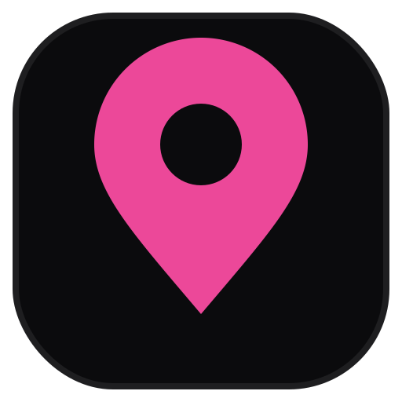

<div align="center">



# ConfessItUp 

**Anonymous confessions, hyper-local to wherever you are.**

City. Society. Street. College. University. Even your building.
No global noise — just your local vibe.

[](https://nextjs.org)
[](https://react.dev)
[](https://supabase.com)
[](https://ui.shadcn.com)
[](https://vercel.com)
[](#license)

</div>

---

## What is this?

ConfessItUp is a **location-based anonymous confession app**. Every place gets its own private-feeling feed — pick your city, your society, your street, your college — and only the confessions from *that* spot show up. No algorithm, no global timeline, just the people around you saying the things they'd never say out loud.

Built MVP-style: fast to ship, fun to use, zero accounts required.

---

## ⚡ Features

| | |
|---|---|
| 🕵️ **Fully anonymous** | No login, no auth, no tracking back to a person |
| 📍 **Any kind of area** | City, neighborhood, society, street, college, university, or your own building |
| 🧵 **Dynamic local feeds** | `/[city]` routes generate a feed for any registered area |
| ❤️ **Like confessions** | One tap, fingerprinted so you can't like the same post twice |
| ✍️ **Post in seconds** | 250-word cap, emoji picker, no friction |
| 📬 **Request your area** | Landing-page form lets anyone ask for a new area to be added — lands straight in the founder's inbox |
| 🎨 **Polished UI** | Dark, pink-accented theme built with shadcn/ui + Tailwind, animated with GSAP |

---

## 🛠 Tech Stack

- **Frontend** — Next.js 13 (App Router), React 18
- **UI** — shadcn/ui + Tailwind CSS, Instrument Serif + Inter
- **Animation** — GSAP
- **Backend** — Supabase (Postgres, Row-Level Security, RPCs)
- **Forms** — Formspree (for the "Request your area" submissions)
- **Deployment** — Vercel
- **Auth** — None by design — the whole point is anonymity

---

## 🚀 Quick Start

```bash
# 1. Clone the repo
git clone https://github.com/fraiser-labs/ConfessItUp.git
cd ConfessItUp

# 2. Install dependencies
npm install

# 3. Set up your environment
cp .env.example .env.local
# then fill in your Supabase URL + anon key

# 4. Run it
npm run dev
```

Open [http://localhost:3000](http://localhost:3000) and you're live.

---

## 📍 Adding a new area

Areas aren't limited to cities — a "city" in the schema is really just *a place with a feed*. Add a row to the `cities` table in Supabase for any:

- City or town
- Neighborhood or society
- Street
- College or university campus
- Apartment building or complex

...and it instantly gets its own confession feed at `/[slug]`.

Don't have DB access? Anyone can request an area straight from the landing page — it emails the team directly.

---

## 🗂 Project Structure

```
app/
  [city]/page.tsx          # Local feed for a given area
  confession/[id]/page.tsx # Single confession + like button
lib/
  confessions.ts           # Confession CRUD + fetch helpers
  city.ts                  # Area lookup helpers
  likes.ts                 # Anonymous like/unlike logic
components/
  RequestAreaSection.tsx   # "Request your area" form for the landing page
```

---

## 🤝 Contributing

PRs and area requests both welcome. If you want your college, society, or street added, use the **Request your area** form on the site — or open an issue.

---

## 📄 License

MIT — do what you want with it.

<div align="center">

Made for fun, feelings, and finding out what your street *really* thinks.

</div>